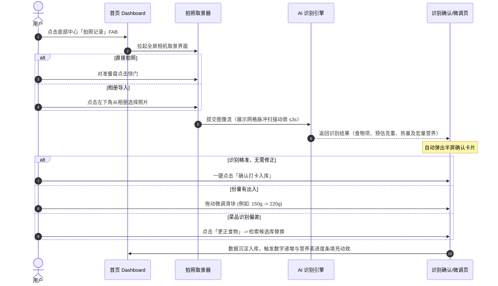

# 《AI卡路里拍照识别与摄入管理》UI/UX 交互设计规范与原型方案 (MVP)

> **版本**：v1.0.0 (MVP Release)  
> **角色**：UI/UX 设计师  
> **关联需求**：TASK-27 产品需求规格说明书 (PRD)  
> **设计目标**：打造极简、低认知负荷、高容错率的卡路里与宏量营养素摄入管理体验，确保 3 步内完成摄入记录闭环。

---

## 目录
1. [设计理念与设计系统规范 (Design System)](#1-设计理念与设计系统规范-design-system)
2. [信息架构与核心用户旅程 (Information Architecture & User Journeys)](#2-信息架构与核心用户旅程-information-architecture--user-journeys)
3. [核心界面原型与布局线框 (Wireframes & Screen Layouts)](#3-核心界面原型与布局线框-wireframes--screen-layouts)
   - 3.1 每日摄入概览 Dashboard (首页)
   - 3.2 拍照/相册识别主流程与扫描动效
   - 3.3 识别结果确认卡片与宏量营养素分解
   - 3.4 食物搜索与快速手动微调 (份量滑块/数值校准)
   - 3.5 历史记录时间轴与餐次明细视图
4. [组件级微交互与异常状态处理 (Micro-interactions & Edge Cases)](#4-组件级微交互与异常状态处理-micro-interactions--edge-cases)
5. [自测要点与工程落地建议 (Implementation & Validation Checklist)](#5-自测要点与工程落地建议-implementation--validation-checklist)

---

## 1. 设计理念与设计系统规范 (Design System)

### 1.1 设计价值观
- **轻量高效 (Frictionless)**：饮食记录是高频刚需行为，核心拍照到入库操作链路严格控制在 ≤3 步以内。
- **直观透明 (Visual Clarity)**：热量收支与三大营养素（碳水/蛋白质/脂肪）通过语义化高识别度色彩呈现，信息一目了然。
- **从容容错 (Forgiving & Adaptive)**：AI 识别预估天然存在物理误差，交互中给予用户最低阻力的快速份量微调与食物重选通道。

### 1.2 色彩体系 (Color Palette)

| 色彩角色 | 色值 (Hex) | 用途说明 |
| :--- | :--- | :--- |
| **主品牌色 (Primary Vitality)** | `#10B981` (Emerald 500) | 健康绿、主要操作按钮 (CTA)、达标正常状态 |
| **辅助活力色 (Accent)** | `#059669` (Emerald 600) | 交互高亮、选中激活态 |
| **蛋白质专属色 (Protein)** | `#3B82F6` (Blue 500) | 蛋白质进度条、营养标签 |
| **脂肪专属色 (Fat)** | `#F59E0B` (Amber 500) | 脂肪进度条、营养标签 |
| **碳水化合物专属色 (Carbs)** | `#EC4899` (Pink 500) | 碳水化合物进度条、营养标签 |
| **警告/超标色 (Over-limit)** | `#EF4444` (Red 500) | 热量超标警示、识别失败提示 |
| **中性底色 (Background)** | `#F8FAFC` (Slate 50) | 页面整体轻质浅色背景 |
| **表面容器色 (Surface/Card)**| `#FFFFFF` (Pure White) | 内容卡片底色，浮起阴影提升层级感 |
| **文字主色 (Text Primary)** | `#0F172A` (Slate 900) | 标题、核心关键数值 |
| **文字次色 (Text Secondary)**| `#64748B` (Slate 500) | 辅助说明、副标题、单位标签 |
| **边框分隔色 (Border/Divider)**| `#E2E8F0` (Slate 200) | 细线分隔、卡片描边 |

### 1.3 排版体系 (Typography)
- **字体族**：
  - iOS: `SF Pro Display`, `SF Pro Text`, `PingFang SC`
  - Android: `Roboto`, `Noto Sans SC`
  - 数字展示统一支持等宽特性 (`font-variant-numeric: tabular-nums`)，防止数字动态跳动时页面震颤。
- **字阶规范**：
  - 核心数值展示 (Display): `36px` / Line-height `44px` / Bold (如仪表盘剩余大热量)
  - 模块大标题 (H1): `24px` / Line-height `32px` / Semi-Bold
  - 卡片小标题 (H2): `18px` / Line-height `26px` / Semi-Bold
  - 正文文本 (Body): `15px` / Line-height `22px` / Regular
  - 次要说明/辅助标签 (Caption): `12px` / Line-height `16px` / Regular

### 1.4 间距与圆角 (Spacing & Radius)
- **间距网格 (8pt Grid)**: `4px`(xs), `8px`(sm), `16px`(md), `24px`(lg), `32px`(xl)
- **圆角规范**:
  - 小型标签/微调按钮: `8px`
  - 标准信息卡片: `16px`
  - 底部浮层 (Bottom Sheet) / 模态卡片: `24px` (顶部圆角)
  - 浮动操作按钮 (FAB) / 药丸胶囊 (Pill Tag): `9999px` (完全胶囊圆角)
- **阴影规范 (Elevation)**:
  - Card Shadow: `0px 2px 8px rgba(15, 23, 42, 0.06)`
  - Elevated/FAB Shadow: `0px 8px 24px rgba(16, 185, 129, 0.25)`

---

## 2. 信息架构与核心用户旅程 (Information Architecture & User Journeys)

### 2.1 整体应用信息架构 (MVP)
```
[AI卡路里助手 MVP]
├── 1. 首页 Dashboard
│   ├── 顶部日期切换器 (今日 / 历史前后切换)
│   ├── 今日能量收支差额大卡片 (目标 vs 已摄入 vs 剩余)
│   ├── 三大宏量营养素达标环形/线性指示器 (碳水/蛋白/脂肪)
│   ├── 餐次分组时间轴列表 (早餐 / 午餐 / 晚餐 / 加餐)
│   └── 底部全局快捷悬浮入口 (FAB: 快速拍照识别 / 相册上传)
│
├── 2. 拍照识别流 (Core Pipeline)
│   ├── 相机取景界面 (网格辅助线、闪光灯、相册导入快捷项)
│   ├── 动态 AI 脉冲扫描态 (雷达扫描波、目标检测微缩框)
│   └── 识别结果确认浮层 (食物项名称、置信度、总热量、三大营养素)
│
├── 3. 误差校准与食物微调
│   ├── 份量滑块/预设克重快捷微调 (0.5份 / 1.0份 / 2.0份 / 电子秤精确克重)
│   └── 食物库搜索重选 (候选列表、热量库模糊检索)
│
└── 4. 餐次归档与历史明细
    ├── 确认入库动效与每日进度条增量飞入
    └── 历史明细展开视图 (缩略图、单项拆解、快捷删除/重编辑)
```

### 2.2 用户核心体验旅程 (Core User Flow)


---

## 3. 核心界面原型与布局线框 (Wireframes & Screen Layouts)

### 3.1 每日摄入概览 Dashboard (首页)
```
+-------------------------------------------------------+
|  18:04                [ 4G ] [ 电池 95% ]              |
|                                                       |
|  [ 👤 我的 ]        2026年11月22日 星期日      [ 📅 日历 ]|
|  < 上一日                 【 今天 】                 下一日 >|
+-------------------------------------------------------+
| 🎯 今日摄入概览 (Daily Energy Balance)                 |
| +---------------------------------------------------+ |
| |                                                   | |
| |        ( 剩余还可吃 )                              | |
| |            650                                    | |
| |           kcal                                    | |
| |                                                   | |
| |  目标: 2,000 kcal        已摄入: 1,350 kcal        | |
| |  [===========================--------] 67.5%      | |
| |                                                   | |
| |  - - - - - - - - - - - - - - - - - - - - - - - -  | |
| |  三大营养素达成进度 (Macronutrients)              | |
| |                                                   | |
| |  [碳水] 180g / 250g  [====================----] 72%|
| |  [蛋白]  75g / 100g  [=================-------] 75%|
| |  [脂肪]  38g /  55g  [=====================---] 69%|
| +---------------------------------------------------+ |
|                                                       |
| 🕒 今日餐次明细 (Meals Breakdown)                      |
| +---------------------------------------------------+ |
| | 🍳 早餐  (08:30)                    380 kcal      | |
| | [全麦面包 + 水煮蛋 + 美式咖啡]             展开 (v) | |
| +---------------------------------------------------+ |
| | 🥗 午餐  (12:45)                    720 kcal      | |
| | [香煎鸡胸肉沙拉 + 糙米饭]                  展开 (v) | |
| +---------------------------------------------------+ |
| | 🍲 晚餐  (未记录)                   建议 ≤500 kcal | |
| | + 点击快捷添加晚餐                                | |
| +---------------------------------------------------+ |
| | 🍇 加餐  (16:00)                    250 kcal      | |
| | [无糖希腊酸奶 + 蓝莓一把]                  展开 (v) | |
| +---------------------------------------------------+ |
|                                                       |
|                                                       |
|                       [ 📷 拍照识别 ]                  |
|                   (底部居中悬浮药丸 FAB)              |
+-------------------------------------------------------+
```

### 3.2 拍照/相册识别主流程与扫描动效
```
+-------------------------------------------------------+
| [ X 关闭 ]               [ ⚡ 闪光灯: 关 ]   [ ❓ 帮助 ]|
|                                                       |
|                    ┌─────────────┐                    |
|                    │  智能识别中 │                    |
|                    └─────────────┘                    |
|                                                       |
|            ┌ - - - - - - - - - - - - - ┐              |
|            ╓───────────────────────────╖              |
|            ║   AI 食物特征雷达波扫描   ║              |
|            ║    [ ======= 绿光 ======= ]║              |
|            ║                           ║              |
|            ║      [ 检测框: 煎牛排 ]    ║              |
|            ║                           ║              |
|            ╙───────────────────────────╜              |
|            └ - - - - - - - - - - - - - ┘              |
|                                                       |
|          💡 保持光线明亮，将食物完整置于取景框中        |
|                                                       |
|  +--------+                                           |
|  | [相册] |               ( ⚪ 快门 )                 |
|  +--------+                                           |
+-------------------------------------------------------+
```

### 3.3 识别结果确认卡片 (半屏浮层 Bottom Sheet)
```
+-------------------------------------------------------+
|                  ══════ 拖动手柄 ══════                |
|  AI 识别成功 (匹配度 96%)                    [ X 放弃 ]|
|                                                       |
|  +----------+  香煎西冷牛排 (Sirloin Steak)           |
|  | [缩略图] |  预计份量: 200 克 (标准单人份)          |
|  |  (牛排)  |  热量估算: 488 kcal                     |
|  +----------+  餐次分配: [ 早餐 | ●午餐 | 晚餐 | 加餐 ]|
|                                                       |
|  三大宏量营养素拆解:                                  |
|  • 蛋白质: 46.2 g (42%)  [============]               |
|  • 脂肪:   32.0 g (54%)  [==============]             |
|  • 碳水:    1.2 g ( 4%)  [=]                          |
|                                                       |
|  ---------------------------------------------------  |
|  份量微调:                                            |
|  0.5份 (100g)     【 1.0份 (200g) 】     1.5份 (300g) |
|  [ - ]  <━━━━━━━●━━━━━━━━━━━━━━━━━━━━>  [ + ]         |
|                                                       |
|  [ 🔍 识别不准？搜索替换 ]       [ ✏️ 手动输入精确克重 ] |
|                                                       |
|  +-------------------------------------------------+  |
|  |         ✅ 确认记录 (+488 kcal)                 |  |
|  +-------------------------------------------------+  |
+-------------------------------------------------------+
```

### 3.4 食物搜索与手动误差修正模态
```
+-------------------------------------------------------+
|  < 返回              更正食物项              [ 搜索 ]  |
|  [ 🔍 请输入食物名称，如：煎鸡胸肉 / 苹果...         ] |
|                                                       |
|  热搜候选: [ 沙拉 ] [ 水煮蛋 ] [ 燕麦 ] [ 拿铁 ]      |
|                                                       |
|  候选匹配结果 (按常见度排序):                         |
|  +-------------------------------------------------+  |
|  | ● 香煎西冷牛排 (当前选定)              244 kcal/100g|
|  |   高蛋白 · 低碳水                                 |
|  +-------------------------------------------------+  |
|  | ○ 菲力牛排 (瘦肉率更高)                188 kcal/100g|
|  |   高蛋白 · 低脂                                   |
|  +-------------------------------------------------+  |
|  | ○ 黑椒牛柳炒彩椒                      165 kcal/100g|
|  |   均衡搭配                                       |
|  +-------------------------------------------------+  |
|                                                       |
|  自定义份量数值微调:                                  |
|  当前食物: 菲力牛排                                   |
|  数量/克重: [  180  ] g       计算热量: 338 kcal       |
|                                                       |
|  +-------------------------------------------------+  |
|  |                替换并保存更改                   |  |
|  +-------------------------------------------------+  |
+-------------------------------------------------------+
```

### 3.5 历史时间轴与餐次明细展开视图
```
+-------------------------------------------------------+
|  < 返回历程               餐次明细列表         2026/11/22 |
|                                                       |
|  ● 08:30  早餐 (380 kcal)                             |
|  +-------------------------------------------------+  |
|  | [图] 全麦吐司 (2片/60g)                  152 kcal|  |
|  | [图] 水煮白壳蛋 (1颗/50g)                 78 kcal|  |
|  | [图] 冰美式 (无糖/300ml)                    5 kcal|  |
|  | [图] 纯牛奶 (200ml)                      145 kcal|  |
|  |                                [编辑] [删除条目] |  |
|  +-------------------------------------------------+  |
|                                                       |
|  ● 12:45  午餐 (720 kcal)                             |
|  +-------------------------------------------------+  |
|  | [图] 香煎西冷牛排 (200g)                 488 kcal|  |
|  | [图] 杂粮五谷糙米饭 (1碗/150g)           174 kcal|  |
|  | [图] 清炒西兰花 (150g)                    58 kcal|  |
|  |                                [编辑] [删除条目] |  |
|  +-------------------------------------------------+  |
|                                                       |
|  ○ 19:30  晚餐 (待记录)                               |
|  + - - - - - - - - - - - - - - - - - - - - - - - - +  |
|  | 还没有记录晚餐，点击拍照即刻补卡...                 |  |
|  + - - - - - - - - - - - - - - - - - - - - - - - - +  |
+-------------------------------------------------------+
```

---

## 4. 组件级微交互与异常状态处理 (Micro-interactions & Edge Cases)

### 4.1 核心组件交互细节
1. **拍照主按钮 (FAB - Floating Action Button)**：
   - 处于首页右下角或底部居中。常驻阴影深度 8dp，向下滚动信息流时胶囊收缩为圆形相机图标以让渡阅读空间；停止滚动恢复展开。
   - 点击时提供 iOS Haptic Feedback (中度触感震动反馈)，立刻拉起相机取景器。
2. **AI 识别雷达动效 (Scanning Animation)**：
   - 取景画面出现上下往复循环移动的 Emerald 激光扫描线，附带半透明光晕 (`rgba(16, 185, 129, 0.25)`)。
   - 画面识别出物体轮廓时，出现动态缩放对焦矩形框（带圆角和角标动画），并浮现识别中的骨架占位波纹，视觉反馈控制在 ≤3 秒。
3. **份量微调滑动条 (Portion Slider)**：
   - 支持双模式：步进档位 (0.5x / 1.0x / 1.5x / 2.0x 快速刻度吸附) + 连续无级滑动手感。
   - 滑块拖拽过程中，上方总卡路里及碳水/蛋白/脂肪克数毫秒级即时联动渲染计算，配合微弱轻度触感反馈。
4. **入库完成动效 (Confetti & Progress Fill)**：
   - 识别卡片点击「确认记录」后，卡片向下流畅滑出，同时缩略图以抛物线轨迹缩小飞入首页对应的餐次卡片中，仪表盘进度条进行带弹性缓冲 (ease-out-cubic) 的增量填充动画。

### 4.2 异常与极端状态设计 (Edge Cases)

| 场景分类 | 异常场景描述 | 交互方案与降级指引 |
| :--- | :--- | :--- |
| **相机权限未授予** | 用户首次使用拒绝了摄像头权限 | 取景框显示高质感插画引导，提示「需要相机权限以智能识图」，提供「去系统设置开启」和「改为从相册选取」双主操作入口。 |
| **弱网/识别超时** | 超过 3 秒未返回识别数据或网络断开 | 停止扫描动效，弹出 Toast：「网络不给力，图片已暂存本地」，底部提供「重试识别」与「直接手动搜索输入」按钮，确保用户旅程不卡死。 |
| **多食物混杂/置信度低** | 盘中物体模糊、暗光、或混杂多种菜品导致置信度 < 60% | 弹出多选提示框：「识别到了几种可能的食物」，列出 Top 3 可能性标签（如：1. 宫保鸡丁 2. 辣子鸡 3. 红烧肉），允许一键点选修正。 |
| **当日热量严重超标** | 累计热量超出日目标卡路里上限 (如 >110%) | 差额卡片由 Emerald 绿色自然过渡为 Coral 珊瑚红/警戒红色；文案由「剩余还可吃 650 kcal」智能变更为「已超出 180 kcal」，并伴随轻柔提醒文案，避免制造用户焦虑。 |
| **离线离场断网** | 用户处于飞行模式或无信号餐厅 | 允许拍照拍摄并生成本地未同步记录草稿，首页呈现轻量「等待联网同步」小黄点标识，恢复网络后自动后台重试补全营养数值。 |

---

## 5. 自测要点与工程落地建议 (Implementation & Validation Checklist)

### 5.1 UI/UX 体验自测 Checklist
- [x] **操作链路闭环**：用户从点击拍照到完成一次午餐入库确认，标准流程操作点击次数 ≤ 3 次。
- [x] **微调便捷度**：在识别出错误克重时，滑块微调或直接修改数字输入均能在 2 秒内完成。
- [x] **营养素视觉语义统一**：碳水 (Pink)、蛋白质 (Blue)、脂肪 (Amber) 全链路色彩一视同仁，图表、进度条、详情标签色彩绝对一致。
- [x] **无障碍与暗色适配预留**：关键数字对比度符合 WCAG AA 标准 (对比度 ≥ 4.5:1)；字体支持系统大号字模式下的自适应换行，避免截断。

### 5.2 前端研发落地规范建议
1. **组件库推荐**：
   - 移动端混合开发/小程序/Web：推荐基于 TailwindCSS + Radix/Headless UI 或 Lucide Icons 构建，轻量无冗余。
2. **性能与感知延迟优化**：
   - 用户拍照快门触发瞬间即在前端本地展示所摄位图并附带骨架扫描态，异步并行上传图片与请求推理，消除白屏等待感。
3. **数据响应同步机制**：
   - 本地状态（如 Zustand/Pinia 或 React Query）使用乐观更新策略（Optimistic UI），用户确认入库瞬间立即同步本地 Dashboard 数据，后台异步同步服务端数据库，若失败则回滚并 Toast 提示。
