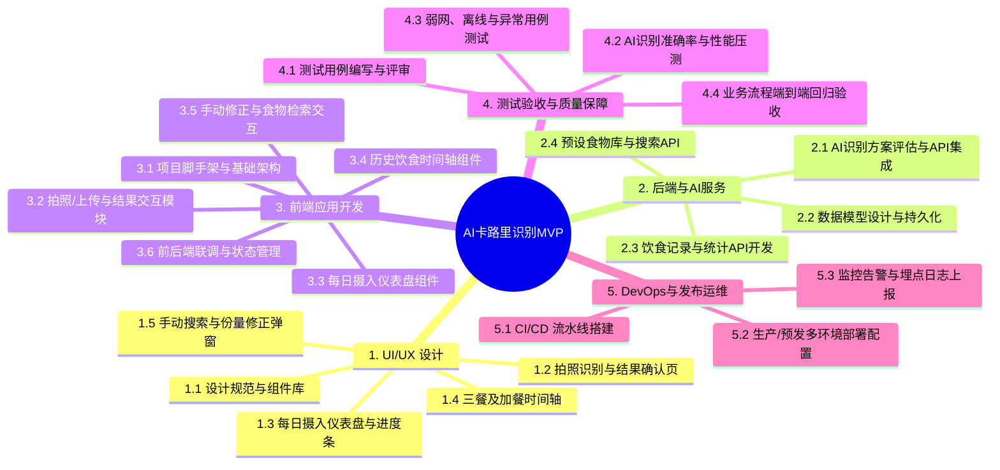
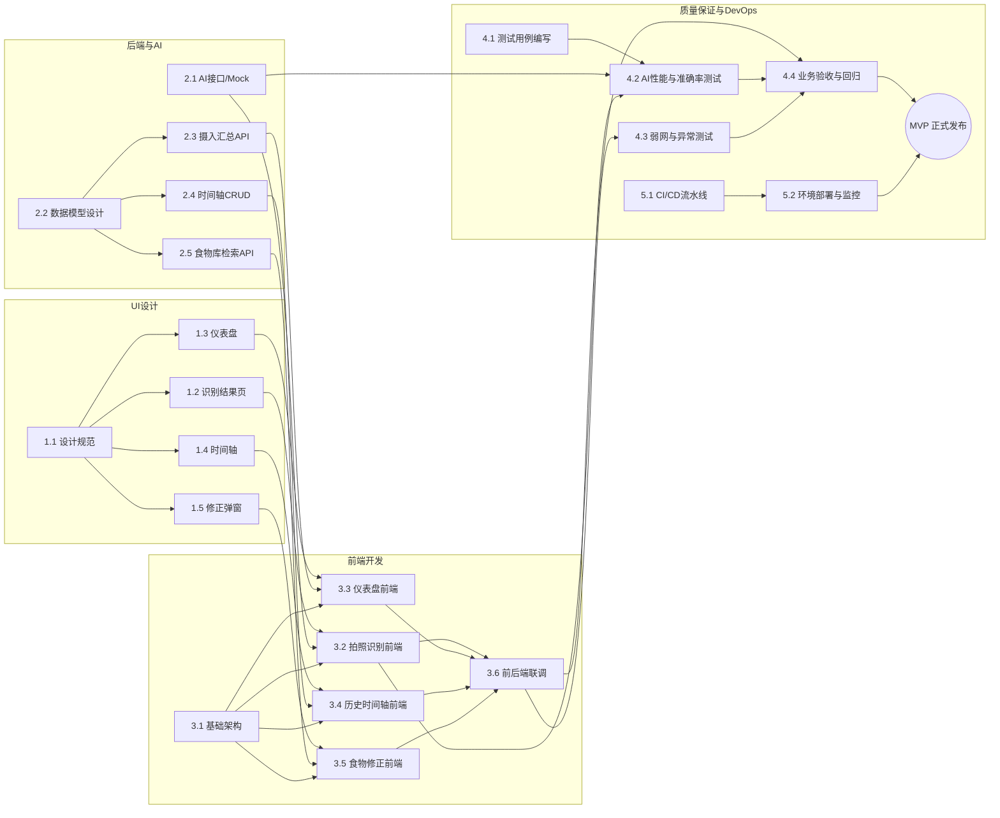

# AI卡路里拍照识别与摄入管理（MVP）WBS工作分解结构与迭代排期规划

## 1. 项目背景与目标

依据 TASK-27 已交付并评审通过的《产品需求规格说明书（PRD）》，本项目旨在构建一款通过食物拍照智能识别热量及核心营养素（蛋白质、脂肪、碳水化合物），并自动统计每日卡路里摄入量、对比目标差额、记录饮食时间轴的 AI 健康助手应用。

本规划文档基于 PRD 的 MVP 范围，对研发全生命周期进行系统性的工作分解结构（WBS）拆解、前后端与算法依赖梳理、关键路径分析、团队角色职责划分、里程碑设置与风险应对策略制定，以指导后续敏捷迭代的高效推进。

---

## 2. 团队角色配置与资源假设

为保障 4 周迭代周期顺利落地，假设标准敏捷敏捷交付团队配比如下：
- **项目经理 / PM**（1人）：总体推进、敏捷站会、风险阻断、里程碑验收。
- **UI/UX 设计师**（1人）：原型交互深度设计、视觉规范与 UI 高保真切图交付。
- **AI / 算法/后端工程师**（1人）：AI 食物识别服务（API选型与包装/Mock）、服务端核心业务接口与数据模型。
- **前端工程师**（移动端/跨平台或 Web 1人）：页面布局、拍照与上传、时间轴、状态管理与接口联调。
- **QA 测试工程师**（1人）：测试用例设计、功能验证、识别边界与异常测试、自动化验收。

---

## 3. WBS 工作分解结构 (Work Breakdown Structure)

### 3.1 详细任务分解表 (WBS Dictionary)

| WBS 编码 | 任务名称 | 任务描述与交付标准 | 负责角色 | 工数估算(人天) | 紧前依赖 |
| :--- | :--- | :--- | :--- | :--- | :--- |
| **1.0** | **UI/UX 设计** | | | **7.5** | |
| 1.1 | 设计规范与全局组件定义 | 定义字体、色彩系统（健康绿/警示橙）、卡片、按钮等基础规范 | UI/UX 设计师 | 1.5 | 无 |
| 1.2 | 拍照与识别结果确认页设计 | 包含拍照引导框、相册选取、识别结果卡片（热量/三大营养素标签及置信度） | UI/UX 设计师 | 2.0 | 1.1 |
| 1.3 | 每日摄入仪表盘与进度条设计 | 环形/条形进度展示每日目标、已摄入、差额；营养素宏观比例图 | UI/UX 设计师 | 1.5 | 1.1 |
| 1.4 | 三餐及加餐时间轴视图设计 | 早/中/晚/加餐分组时间轴卡片、单条记录编辑/删除交互 | UI/UX 设计师 | 1.5 | 1.1 |
| 1.5 | 手动搜索与份量修正交互弹窗 | 食物检索列表、预设单位切换（克/份/碗）、滑动条修正数值 | UI/UX 设计师 | 1.0 | 1.1 |
| **2.0** | **后端与 AI 服务开发** | | | **9.5** | |
| 2.1 | AI 识别 API 选型、接入与 Mock 服务 | 对比第三方食物识别 API（或自研多模态模型），完成封装鉴权与降级 Mock | 后端/算法 | 2.5 | 无 |
| 2.2 | 领域数据模型设计与数据库建表 | 用户画像目标表、摄入流水表、食物营养成分字典库表设计与索引优化 | 后端工程师 | 1.5 | 无 |
| 2.3 | 每日摄入汇总与目标计算接口 | 提供获取/设置日卡路里目标、实时计算当日已摄入与营养占比统计接口 | 后端工程师 | 2.0 | 2.2 |
| 2.4 | 历史记录 CRUD 与时间轴接口 | 提供按日期、餐次分组的分页查询接口，支持单项修改与删除 | 后端工程师 | 1.5 | 2.2 |
| 2.5 | 基础食物字典库检索 API | 提供基础常见食物（约200-500种）模糊搜索与卡路里换算 API | 后端工程师 | 2.0 | 2.2 |
| **3.0** | **前端应用与交互开发** | | | **11.5** | |
| 3.1 | 前端工程脚手架与网络/存储层搭建 | 初始化项目架构、封装 HTTP 请求层、本地缓存及路由系统 | 前端工程师 | 1.5 | 无 |
| 3.2 | 拍照/相册上传与识别结果确认页 | 调用系统相机/相册上传图片，展示 Loading 动效与识别卡片，支持修改 | 前端工程师 | 3.0 | 1.2, 2.1, 3.1 |
| 3.3 | 每日摄入仪表盘与进度条组件 | 实现动态进度条与差额展示，支持目标超额警示高亮 | 前端工程师 | 1.5 | 1.3, 2.3, 3.1 |
| 3.4 | 历史记录时间轴与餐次列表 | 渲染早中晚及加餐分组记录，集成滑动删除与卡片折叠交互 | 前端工程师 | 2.0 | 1.4, 2.4, 3.1 |
| 3.5 | 手动搜索食物与份量修正弹窗 | 防抖搜索食物库、快捷选择份量单位并回填至记录 | 前端工程师 | 1.5 | 1.5, 2.5, 3.1 |
| 3.6 | 前后端业务联调与数据同步 | 端到端全链路数据闭环联调，本地离线缓存与状态同步 | 前端工程师 | 2.0 | 3.2-3.5, 2.1-2.5 |
| **4.0** | **测试验证与质量保证** | | | **6.5** | |
| 4.1 | 测试方案与场景测试用例编写 | 针对 PRD 验收标准设计功能、AI 准确度、异常与边界用例 | QA 工程师 | 1.5 | 1.2-1.5, 2.2 |
| 4.2 | AI 识别性能与准确率专项测试 | 验证常用食物图片识别精度（≥85%）与响应延时（≤3s） | QA 工程师 | 2.0 | 2.1, 3.2 |
| 4.3 | 弱网、离线与异常网络专项测试 | 模拟弱网超时、断网本地记录保留、上传中断恢复等健壮性测试 | QA 工程师 | 1.5 | 3.6 |
| 4.4 | 迭代全量业务回归与验收测试 | 全流程业务冒烟与回归，跨机型适配测试，阻断 Bug 清零 | QA 工程师 | 1.5 | 3.6, 4.2, 4.3 |
| **5.0** | **DevOps 与上线部署** | | | **3.0** | |
| 5.1 | CI/CD 构建流水线与自动化检查 | 配置 Lint、单元测试运行、自动化镜像构建与部署脚本 | 后端/DevOps | 1.5 | 2.1, 3.1 |
| 5.2 | 运行环境搭建与监控埋点配置 | 部署预发与生产环境，配置日志收集、APM 接口响应监控与告警 | 后端/DevOps | 1.5 | 5.1 |

---

## 4. 依赖关系分析与网络图

### 4.1 核心依赖链路
1. **设计驱动前端**：1.1（设计规范）为所有 UI 设计前置；1.2~1.5 分别阻断前端对应模块的实现（3.2~3.5）。
2. **后端支撑前端**：
   - 2.1（AI 服务接入/Mock）阻断 3.2（识别交互前端）。
   - 2.2（数据模型）阻断 2.3~2.5。
   - 2.3~2.5 分别与前端 3.3~3.5 接口联调。
3. **联调阻断测试与上线**：3.6（端到端联调完成）阻断 4.3（异常弱网测试）与 4.4（终验回归）。

### 4.2 依赖拓扑图

### 4.3 关键路径 (Critical Path) 分析
**关键路径耗时：18.5 工作日（约 3.7 周）**
- `[项目启动]` → `1.1 设计规范 (1.5d)` → `1.2 识别交互设计 (2.0d)` → `3.2 拍照识别组件开发 (3.0d)` → `3.6 前后端综合联调 (2.0d)` → `4.3 弱网/异常与 4.4 验收回归 (3.0d)` → `4.4 验收评审与交付 (1.0d)`
- **说明**：拍照识别及结果确认是用户核心主链路，涉及第三方 AI 服务集成与复杂前端交互，是制约整体进度的最核心路径。

---

## 5. 迭代排期规划 (4周敏捷迭代)

本项目采用为期 **4 周（20 个工作日）** 的敏捷迭代周期：

| 周期阶段 | 时间跨度 | 阶段目标 | 核心任务与输出 | 里程碑节点 |
| :--- | :--- | :--- | :--- | :--- |
| **Sprint 1** 架构与设计先行 | Day 1 ~ Day 5 | 完成全套 UI 设计、AI 模型选型/Mock 确立、数据表与基础脚手架就绪 | - 交付 1.1~1.5 UI 高保真切图与交互原型 - 完成 2.1 AI 服务选型并输出 Mock API - 完成 2.2 数据模型建表与 3.1 前端脚手架搭建 - 启动 4.1 测试用例设计 | **M1: 设计与架构评审通过 (Day 5)** |
| **Sprint 2** 核心业务功能研发 | Day 6 ~ Day 10 | 完成拍照识别主干、数据统计与历史记录前后端功能编码 | - 完成 2.3 每日摄入统计接口与 2.4 时间轴接口 - 完成 3.2 拍照上传识别交互模块 - 完成 3.3 仪表盘与 3.4 时间轴页面组件 - 完成 5.1 CI/CD 自动化流水线搭建 | **M2: 核心功能演示 (Demo Day 10)** |
| **Sprint 3** 修正功能与系统联调 | Day 11 ~ Day 15 | 完成食物库搜索与修正弹窗，实现端到端接口全面联调 | - 完成 2.5 基础食物库 API 与 3.5 修正弹窗交互 - 全面展开 3.6 前后端联调，打通拍照到记录全闭环 - 启动 4.2 AI 识别准确率专项测试（样本评测） - 完成 5.2 预发环境部署与监控接入 | **M3: 代码冻结与系统提测 (Day 15)** |
| **Sprint 4** 测试验收、性能调优与发布 | Day 16 ~ Day 20 | 专项测试、Bug 修复清零、性能优化、生产发布与交付总结 | - 开展 4.3 弱网异常测试与 4.4 全面回归测试 - 优化 AI 接口识别延时（保证 ≤3s） - 修复阻断/严重缺陷，达成测试准出指标 - 生产环境发布上线与交付物归档 | **M4: MVP 交付上线 (Day 20)** |

### 5.1 详细甘特图 (Gantt Chart)

```mermaid
gantt
    title AI卡路里识别与摄入管理 MVP 迭代排期规划 (20工作日)
    dateFormat  X
    axisFormat Day %d

    section UI/UX设计
    1.1 设计规范与组件库          :active, d1, 0, 2
    1.2 拍照识别与结果确认页设计   :active, d2, 2, 4
    1.3 每日摄入仪表盘与进度条设计 :active, d3, 2, 4
    1.4 三餐历史时间轴设计         :active, d4, 3, 5
    1.5 份量修正交互弹窗设计       :active, d5, 4, 5

    section 后端与AI服务
    2.1 AI接口选型与Mock开发      :crit, b1, 0, 3
    2.2 数据模型设计与建表        :b2, 0, 2
    2.3 每日摄入汇总API           :b3, 2, 4
    2.4 时间轴CRUD接口            :b4, 3, 5
    2.5 基础食物库检索API         :b5, 5, 7

    section 前端开发
    3.1 前端架构与脚手架搭建      :f1, 0, 2
    3.2 拍照上传与结果确认模块    :crit, f2, 4, 8
    3.3 仪表盘与进度条组件        :f3, 4, 6
    3.4 历史记录时间轴组件        :f4, 5, 8
    3.5 食物搜索与修正弹窗        :f5, 7, 9
    3.6 前后端全链路业务联调      :crit, f6, 9, 12

    section 测试与质量保障
    4.1 测试方案与用例编写        :t1, 3, 5
    4.2 AI识别准确率与性能压测    :t2, 8, 11
    4.3 弱网与异常场景专项测试    :t3, 12, 14
    4.4 全功能回归与验收测试      :crit, t4, 14, 17

    section DevOps与部署
    5.1 CI/CD流水线建设           :o1, 2, 4
    5.2 环境部署与监控告警        :o2, 10, 12
    生产发布与验收交付总结        :milestone, m4, 17, 18
```

---

## 6. 关键里程碑与交付验收准则

| 里程碑 | 时间节点 | 达成标志与交付物 | 验收责任人 |
| :--- | :--- | :--- | :--- |
| **M1: 架构与设计基线确立** | Day 5 (Sprint 1 结束) | - UI 高保真设计稿输出并通过评审 - AI 识别服务 API 选型确定，Mock 接口联调可用 - 数据库 DDL 脚本评审并建表完成 | 产品经理、架构师 |
| **M2: 主链路功能集成演示** | Day 10 (Sprint 2 结束) | - 核心链路 Demo 可演示（拍照上传 -> AI 识别出热量/营养成分 -> 回填） - 每日摄入进度条与时间轴基础展示走通 | 项目经理、技术负责人 |
| **M3: 系统代码冻结与提测** | Day 15 (Sprint 3 结束) | - 前后端业务联调完成，全功能闭环 - 基础食物库模糊搜索与手动修正功能就绪 - 提测报告输出，代码冻结进入回归分支 | 前后端开发负责人、QA |
| **M4: MVP 上线与交付** | Day 20 (Sprint 4 结束) | - AI 识别准确率 ≥ 85%，响应耗时 ≤ 3 秒 - P0/P1 Bug 清零，回归测试报告通过 - 生产环境发布完成，操作文档与监控就绪 | 项目经理、全体团队 |

---

## 7. 风险识别与应对措施

| 风险类别 | 风险描述 | 影响度/发生概率 | 应对预防策略 | 应急预案 |
| :--- | :--- | :--- | :--- | :--- |
| **技术/AI 风险** | 第三方食物识别模型准确率低于 85% 或复杂混合菜肴无法精确切分 | 高 / 中 | 1. 调研多家主流视觉识别服务进行对比测试。 2. 建立标准化评测食物图库（常见中西餐标样）。 | 强化 1.5/3.5「手动修正与搜索食物库」交互体验，在置信度低时主动提示用户微调，降低用户挫败感。 |
| **性能风险** | 图片上传和模型推理耗时超过 3s 指标 | 中 / 中 | 1. 客户端在上传前执行无损图片压缩与 EXIF 矫正（限制长边 1080px 内）。 2. 服务端启用 CDN 上传加速与异步并行预热。 | 识别过程中设计友好有趣的骨架屏/营养小贴士加载动效，改善用户主观等待感知。 |
| **进度/依赖风险** | 前后端接口契约变动频繁导致联调阻塞延期 | 高 / 低 | 1. Day 3 前必须冻结前后端 Swagger/OpenAPI 契约。 2. Sprint 1 即提供完备 Mock 服务，前后端并行开发。 | 如遇个别接口延期，前端基于 Mock 继续开发展示，优先保障核心关键路径 3.2 畅通。 |
| **需求蔓延风险** | 团队在开发中过早引入扩展需求（如智能建议、运动抵扣等） | 中 / 高 | 严格执行 PRD 范围边界控制，设立 MVP 变更控制门禁（Change Control）。 | 所有非 MVP 功能（智能饮食建议、个性化 TDEE 等）统一登记至阶段二待办池（Backlog），当前冲刺不做代码开发。 |

---

## 8. 总结与后续推进建议

本规划清晰界定了 MVP 的交付边界与依赖路径：
1. **优先保障关键路径**：重点抓牢「设计规范 -> 识别确认页 -> AI 接口集成 -> 联调验收」这一主干，确保项目最核心卖点按期保质落地。
2. **强化契约先行与 Mock 并行**：在 Sprint 1 尽快冻结 API 规格，利用 Mock 机制最大程度降低前端等待后端的阻塞时间。
3. **闭环容错设计**：鉴于 AI 识别在物理世界上存在天然边界，手动修正与食物库模糊搜索模块是保障产品口碑的生命线，须在 Sprint 3 重点打磨。
